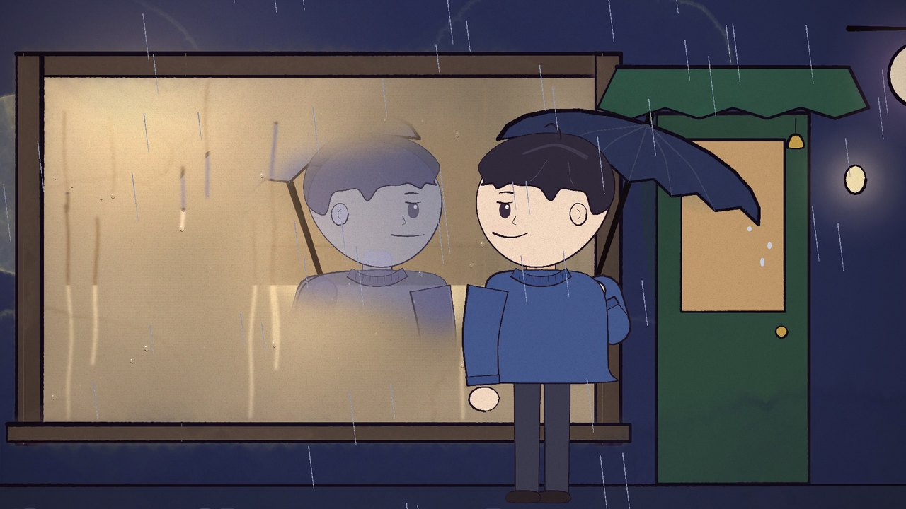
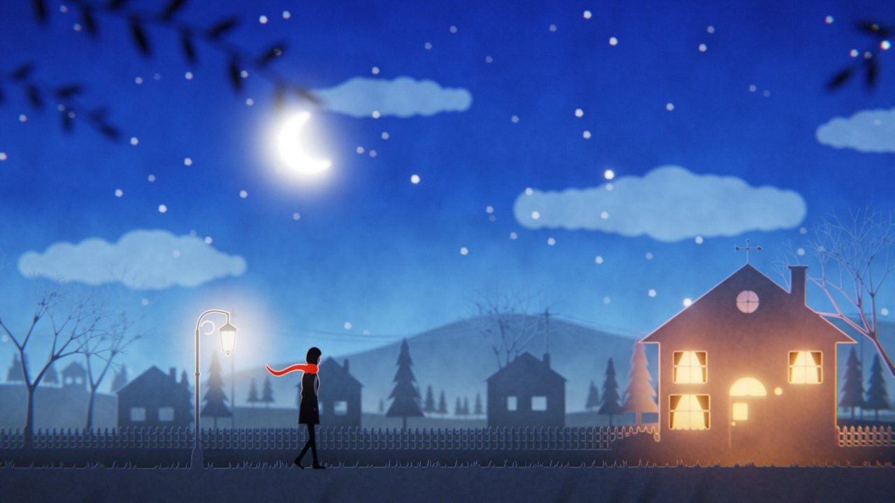
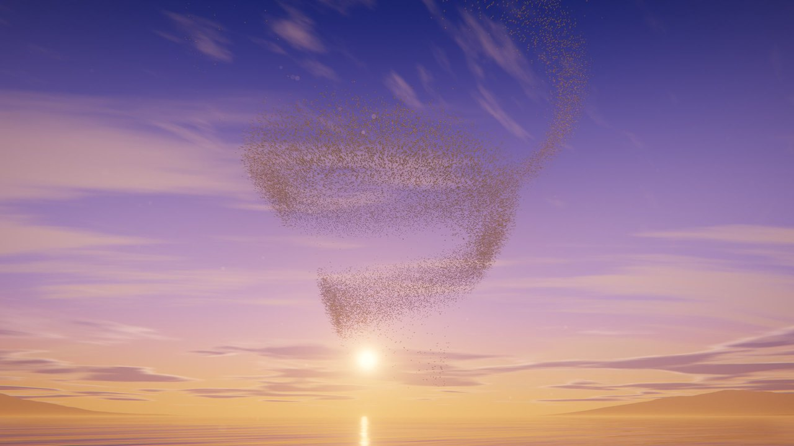
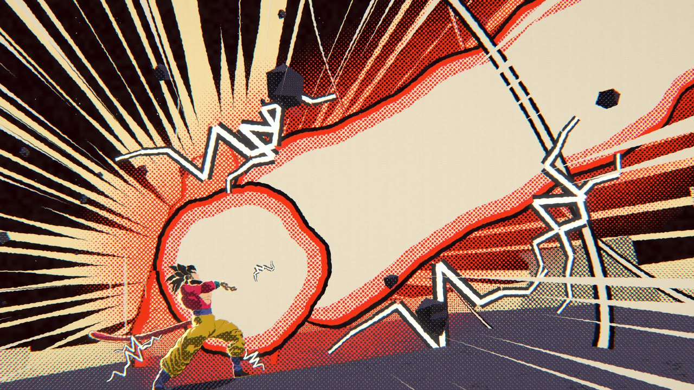
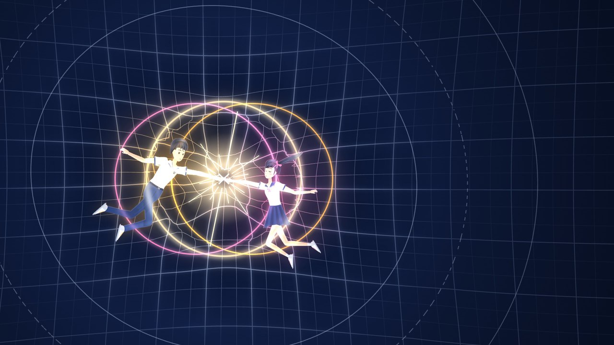
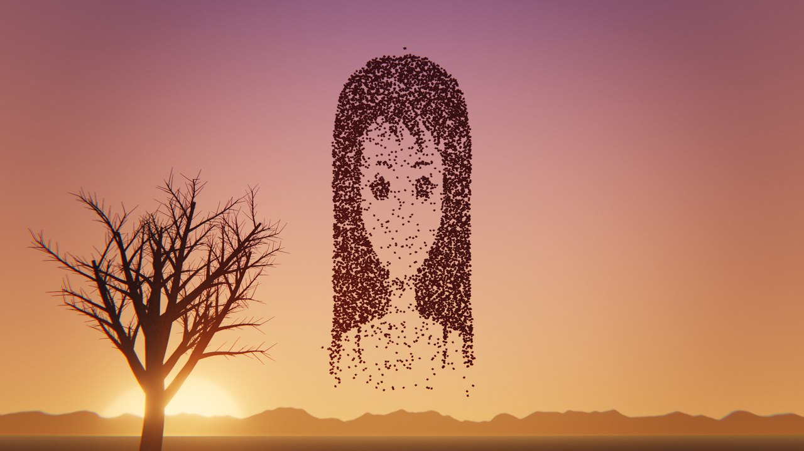
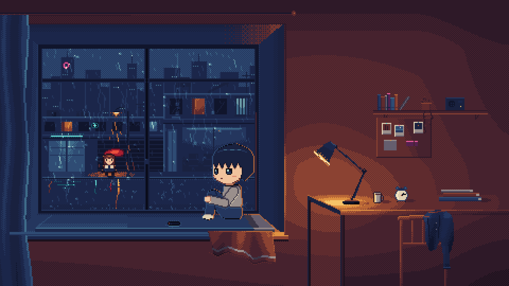

# AI-native Music Video

[中文](README.md) · **English**

A [Claude Code](https://claude.com/claude-code) skill for making an animated music video in which every frame is drawn by code. A browser page using Canvas, WebGL or three.js can draw any moment of the song; headless Chrome renders it frame by frame, and ffmpeg adds the original track. No image or video generation models are involved.

It was distilled from eight films made with Claude Opus 5.5 in Claude Code in September and October 2026. The work was split the same way each time: a person set the direction, watched the cuts and pointed out problems by timestamp; Claude wrote all the code and checked the pictures itself. Each film has a different style:

<table>
<tr>
<td width="50%" valign="top"><br><b><i>Shuo Huang</i> 说谎 · Yoga Lin</b> · hand-painted watercolour picture book<br>full song, 4:24, landscape · p5.js + p5.brush<!-- video:shuohuang --></td>
<td width="50%" valign="top"><br><b><i>Wo Bu Nan Guo</i> 我不难过 · Stefanie Sun</b> · paper-cut lightbox<br>full song, 5:20, landscape · Canvas 2D paper layers + a WebGL2 compositor that passes light through them<!-- video:wobunanguo --></td>
</tr>
<tr>
<td width="50%" valign="top"><br><b><i>BIRDS OF A FEATHER</i> · Billie Eilish</b> · 45,000 birds over a lake at dusk<br>last chorus, 39 s, landscape · three.js; averaged sub-frames give motion blur and depth of field<!-- video:birdsofafeather --></td>
<td width="50%" valign="top"><br><b><i>DAN DAN 心魅かれてく</i> · FIELD OF VIEW</b> · Dragon Ball as a moving manga<br>opening 26 s, vertical · three.js; game models as under-drawing, rendered as screentone and ink<!-- video:wukong --></td>
</tr>
<tr>
<td width="50%" valign="top"><br><b><i>Ren Zhi</i> 人质 · A-Mei</b> · ink and red under water, stained glass at both ends<br>second half, 91 s, vertical · 2D fluid simulation in WebGL<!-- video:renzhi --></td>
<td width="50%" valign="top"><br><b><i>Wan You Yin Li</i> 万有引力 · Silence Wang</b> · a physics lecture drawn in glowing vectors<br>54 s, landscape · Canvas 2D<!-- video:wanyouyinli --></td>
</tr>
<tr>
<td width="50%" valign="top"><br><b><i>Feng</i> 枫 · Jay Chou</b> · chlorophyll prints<br>later part, 102 s, vertical · three.js, procedural plants · first cut done, not released</td>
<td width="50%" valign="top"><br><b><i>Yu Shi</i> 于是 · Zheng Runze</b> · pixel art with chibi characters<br>full song, 3:52, landscape · Canvas 2D, indexed-palette buffer<!-- video:yushi --></td>
</tr>
</table>

For the three vertical films (Dragon Ball, Ren Zhi, Feng) the sample is the same moment framed for landscape. How each style is made and what went wrong: [styles.md](plugins/music-video/skills/music-video/references/styles.md).

## What it does

- **Workflow**: measure the song → fetch character-timed lyrics and align them to the voice → propose two or three directions and make look tests in parallel for you to choose from → character sheets → storyboard and timing table → grow the film's engine out of the chosen look test → subagents write the shots in parallel → self-review with contact sheets, frame strips and full-resolution crops → encode → revise by your timestamps → final pass → wrap-up. You see the result of each step before the next one starts.
- **Rules**: every frame depends only on time, so frames render out of order on several processes and a change re-renders only the shots it touches; before delivery the film is rendered forwards and backwards and compared byte for byte. Lyrics are data only and never appear in any model output. Frame 0 is a finished picture. The content decides between landscape and vertical.
- **Tools**: project setup; rendering (preview, contact sheets, frame strips, crops, whole-film sheets, frame sequences, encoding, comparison); song analysis; fetching character-timed lyrics and aligning them; removing the tail of the previous sung line from the start of an excerpt; frame checks (brightness, black frames, jumps, whether the grain is a lattice); a scan for lyric text that slipped into documents. The scripts were checked against the released films: the same input gives byte-identical output.
- **Experience**: a catalogue of the eight styles (sample pictures, how each is made, why it suited its song, what went wrong, how fast it renders); an anatomy and layer-order checklist for characters; every problem pointed out across the eight films, with what to check next time.

## What it does not do

- Find the music. You provide the audio: the album version, the one the lyric timing matches.
- Write lyric text in replies, files or code. Scripts download and process the lyrics, and the page draws the words from that data.

## Install

In Claude Code:

```
/plugin marketplace add ai-native-workshop/ai-native-music-video
/plugin install music-video@ai-native-music-video
```

Or as a personal skill:

```bash
git clone https://github.com/ai-native-workshop/ai-native-music-video
cp -r ai-native-music-video/plugins/music-video/skills/music-video ~/.claude/skills/
```

## Use

You need Node.js 18+, Python 3 (numpy, scipy, Pillow), ffmpeg and Google Chrome. Removing a vocal tail, locating backing vocals or making an instrumental version also needs audio-separator. The films were made on macOS (Apple Silicon); on other systems without a GPU, WebGL renders much more slowly.

Make an empty folder, put the song in it, open Claude Code there and say what you want, for example:

> Make a full music video for this song; the album version is in this folder. I'd like it quiet and restrained. Show me look tests of two or three directions first.

Running at maximum reasoning effort (`/effort max`) is recommended. The skill's documentation is written in Chinese; Claude follows it either way, and you can talk to it in English.

## Cost

At API prices, a full-song video came to about USD 250–360 (a working day plus two or three rounds of revisions), and a 30–100 second short to about USD 130–240. Most of it goes to the parallel subagents and to character design. You can start with a single 10–16 second look test and decide after seeing it.

## Contents

```
plugins/music-video/skills/music-video/
├── SKILL.md                 rules, workflow, tools, the eight films at a glance
├── references/
│   ├── song.md              audio sources, song analysis, lyrics as data only, lyric timing, captions, excerpts, vocal separation
│   ├── direction.md         from song to film, length and orientation, frame 0, pacing and cutting, action and fan works, directions, look tests
│   ├── styles.md            the style catalogue, with sample pictures
│   ├── characters.md        characters: genre and appeal, ways to build them, model sheets, silhouettes, chibi, 3D models, anatomy checklist
│   ├── production.md        storyboard, timing table, the guide for subagents, parallel work, assembly, revision rounds
│   ├── pipeline.md          page contract, render.mjs, determinism, renderers and speed, encoding and colour
│   ├── review.md            self-review, final pass, review checklist
│   └── wrapup.md            after acceptance, assets and licences, wrap-up
├── scripts/                 new_project.py  render.mjs  analyze_audio.py  fetch_lyrics.py  build_lyrics.py
│                            cut_vocal_tail.py  check_frames.py  check_no_lyrics.py
└── assets/
    ├── project/             page skeleton (page contract, character-by-character captions, example shot, placeholder shot) and make_timing.py
    ├── docs/                templates: storyboard, guide for shot writers, subagent briefs, project README
    └── styles/              sample pictures of the eight films
```

## Maintenance

After each film, add its style (with a sample picture) to `styles.md` and the problems pointed out to the review checklist in `review.md`. Every item on that list actually happened.

## Acknowledgements

- [ClaudeAnimationBase](https://github.com/JohnHeibel/ClaudeAnimationBase) (MIT) and [PDoomVideo](https://github.com/JohnHeibel/PDoomVideo): the starter kit of the first film. The approach (a page that draws any moment, headless Chrome rendering frame by frame, ffmpeg muxing) and the pacing principle of giving the viewer time to understand started there.
- Open-source tools and models used: p5.brush, three.js, puppeteer, ffmpeg, audio-separator with BS-RoFormer, rembg.

## License

MIT
