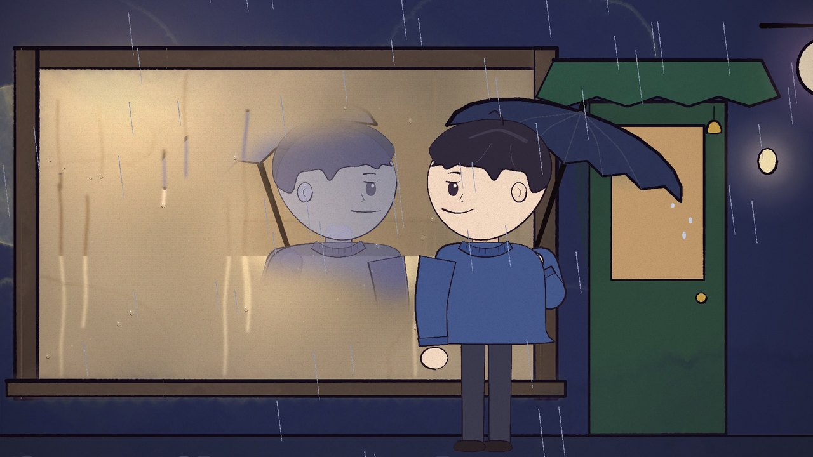
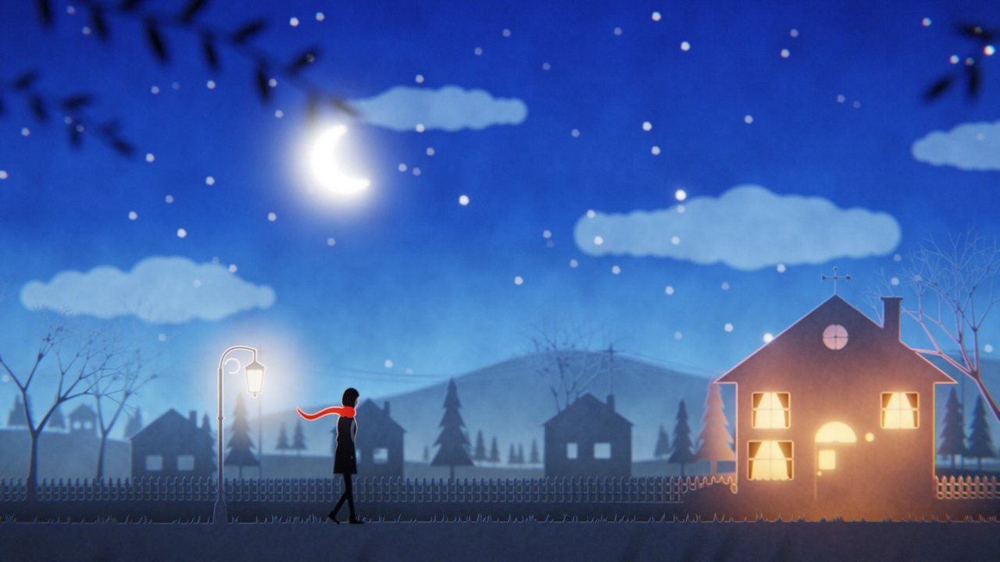
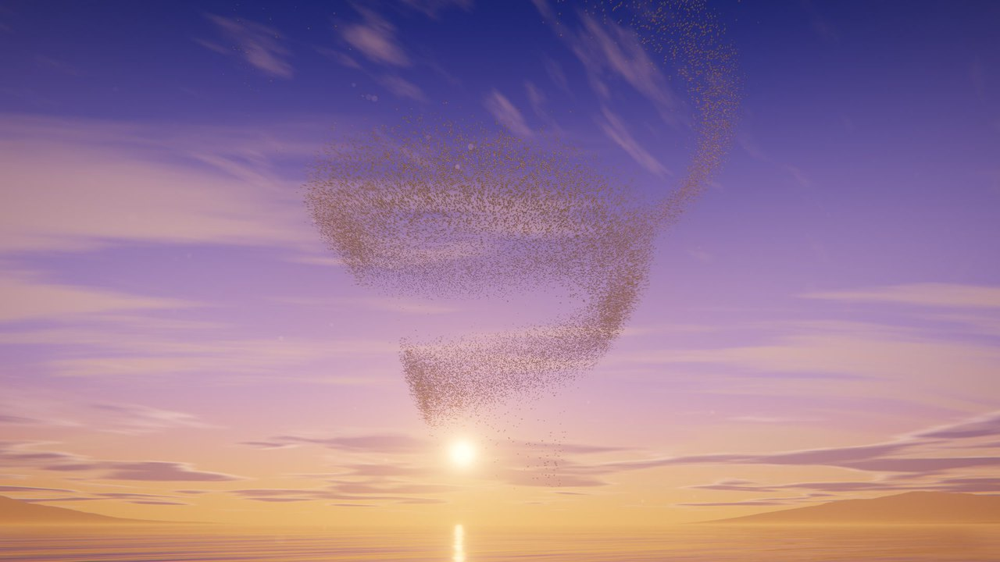
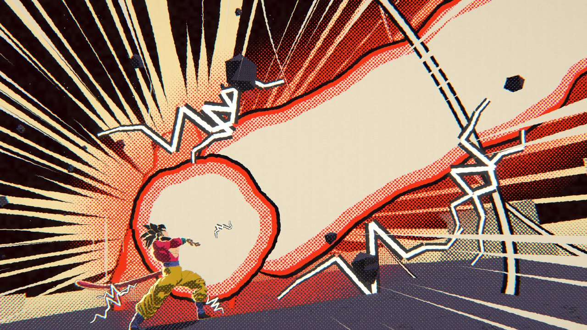
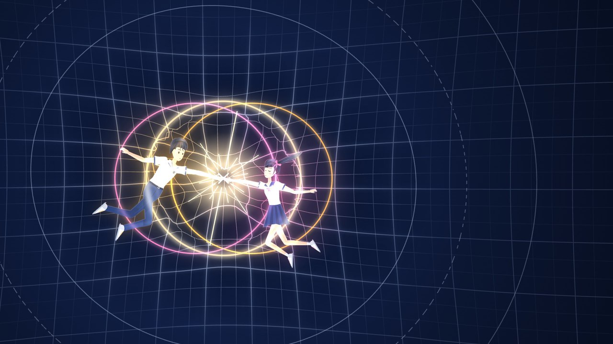
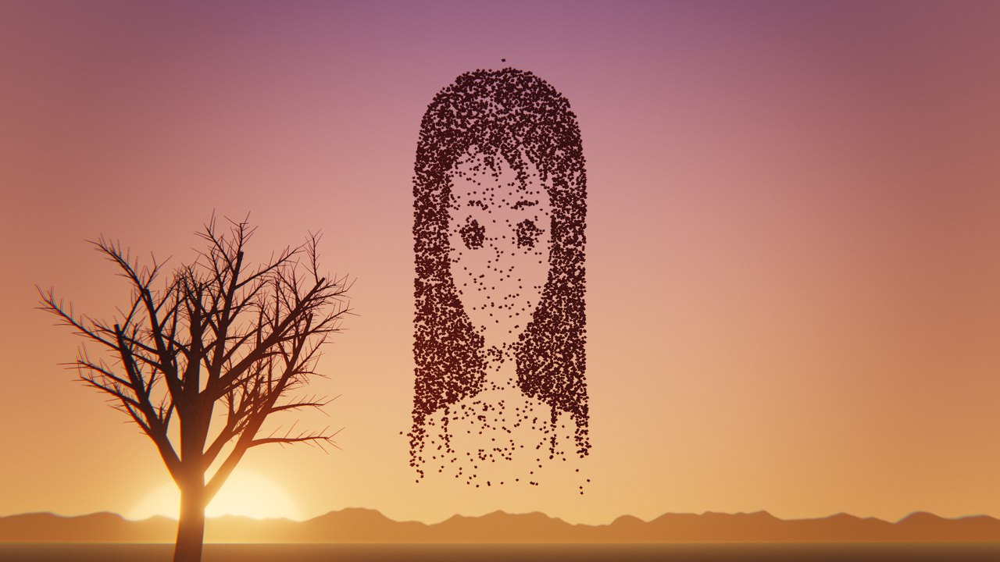
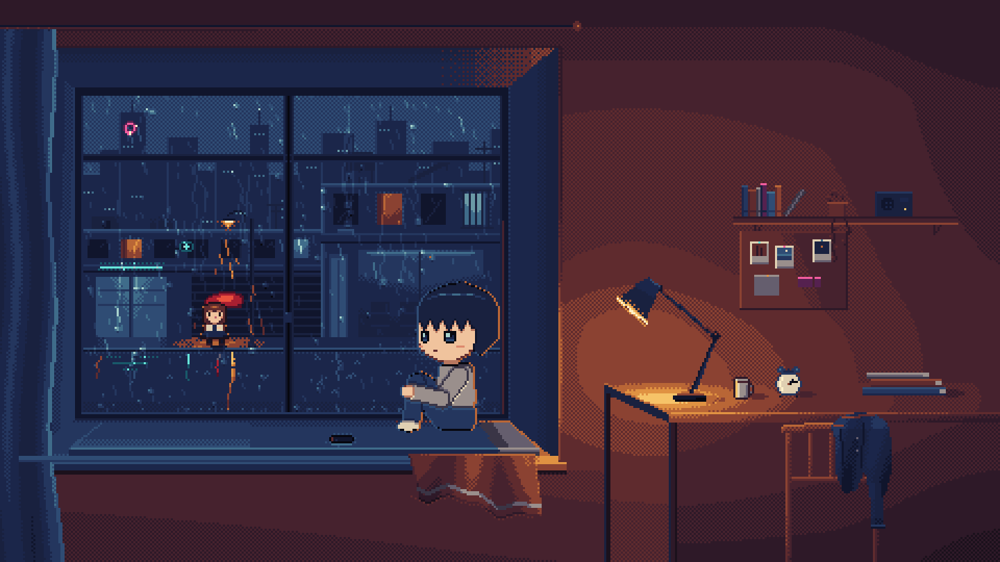

# 画风目录

八支成片各用了一种画风，试片和提案里还有十几种。每一支附一张样图（在 `assets/styles/`，挑画风时可以打开看）和 B 站视频链接；每一条写：观感、怎么做、为什么适合那首歌、精致靠什么、踩过的坑、速度。选画风先读“怎么选”。

## 目录
- 怎么选画风
- 1 手绘水彩绘本：《说谎》
- 2 纸雕灯箱：《我不难过》
- 3 程序化 3D 场景和鸟群：《BIRDS OF A FEATHER》
- 4 会动的漫画：《悟空》
- 5 水下的墨与红，和花窗：《人质》
- 6 发光矢量科普讲堂：《万有引力》
- 7 叶绿素显影：《枫》
- 8 像素和 Q 版：《于是》
- 试过的其他画风
- 提过、没做的

## 怎么选画风

- **让画风演歌词。** 最好的选择都能用一句话说清材料和歌的关系：纸人哭不出来，但纸会湿；水把墨和红带走；一堂物理课研究“喜欢”；叶子把照片印进去，秋天又褪掉。
- **2D 的精致来自材料本身**（纸纹、笔触、网点、调色板、构图），不靠修一个 3D 渲染。3D 擅长环境、光、成群的东西和跟拍的机械运动，弱在人的脸和手、在表演。3D 人物直接渲染三次被否。
- **画风决定人物要多强。** 要靠脸和表情演戏的，人物必须好看（`references/characters.md`）；人物撑不住时，选能藏住人物的画风：剪影、小像素精灵、Q 版、背影、皮影，或者让人物小在大景里。但先问用户，类型不对的“藏”会被否。
- **长度和速度。** 全曲（5000–8000 帧）要每帧几十毫秒以内的引擎和能复用的布景；短片可以用每帧几百毫秒的子画面平均。
- **问一句：会被拿去和什么比？** 3D 卡通渲染会被拿去和游戏比；发光矢量会被拿去和 3Blue1Brown 和那批 Opus 科普视频比；水彩会被拿去和绘本比。说得出为什么不输，才值得做。
- **精致是一层层弱效果叠出来的。** 漫画的质感来自大小略变的网点、暗部排线、粗细游走的描线、边缘一像素的抖动、实黑里的针孔、干刷飞白、彩页的套色错位、纸纹，每一样都很弱，少了哪一样都更像电脑画的。
- **几种画风并排试片让用户挑。** 调研选得出管线，选不出观感：《悟空》调研的首选（三渲二）一出来就被否；用户挑的“会动的漫画”第二种只做了半小时。

---

## 1 手绘水彩绘本：《说谎》

视频：[B 站](https://www.bilibili.com/video/BV1MSYA6GEsV/)

林宥嘉《说谎》全曲 4:24，横屏 1080p，24 帧，10 章 48 镜，5 个子代理。

- **观感**：绘本里的人（大圆头、点点眼），水彩晕染，墨线每秒“沸腾”12 次，纸纹，底部一行逐字的字幕。
- **怎么做**：p5.js + p5.brush（起步包 ClaudeAnimationBase，MIT）。一个形状 = 平涂的底色 + 可选的水彩层 + 可选的墨线描边；抖动的随机数每秒重设 12 次种子，每个独立元素先设自己的种子，否则一个东西一动，后面画的所有线都跟着抖。发光用加法的光（颜料混色不能变亮：黄画在蓝上会发绿）。人物参数化：脸朝向 −1…1、眼型、眉、嘴、泪、手臂三点。姿态和表情“一拍二”（每两帧换一张），镜头不。
- **为什么适合**：一首笑着说谎的抒情歌。表面和真相两层：他一直在笑；窗玻璃里的倒影慢半拍，一遍副歌比一遍拖得多；墙上的影子做他不做的动作；雨痕当眼泪。全片唯一饱和的红是那张请柬。
- **坑**：
  - p5.brush 每帧开头的几次平涂会被吞掉：每帧先垫两笔。
  - 曲线形状选项会随机丢掉填色和描边：先自己算平滑轮廓，当多边形画。
  - 大形状的水彩溢色会漫出边界并闪烁：大形状溢色调到 0.01–0.03。
  - 只有水彩层、没有平涂的全屏形状不显示。
  - 不要用 p5 自带的矩形、椭圆：像 2000 年代的 Flash。
  - 子代理照抄模板：设定图里一个错的手臂姿势被抄进好几章。手臂规则见 `references/characters.md`。
- **速度和成本**：每帧约 0.2 秒，4 线程全片约 20 分钟；折合 256 美元。
- **适合**：抒情慢歌，人物表演为主的故事。

## 2 纸雕灯箱：《我不难过》

视频：[B 站](https://www.bilibili.com/video/BV1UJHz6EEXe/)

孙燕姿《我不难过》全曲 5:20，横屏，24 帧，13 章，7 个子代理约 2 小时 15 分。

- **观感**：每个镜头是灯箱里的小剧场：十几层剪纸叠在不同深度，光从背板透过来，每穿过一层被滤掉一部分，所以深处的纸发亮、近处的纸是剪影；镂空的洞里看到的是后一层纸。再用一个有景深、散景、辉光的镜头去拍它，镜头移动时层与层之间有视差。
- **怎么做**：每层纸用 Canvas 2D 画；一个 WebGL2 合成器按灯箱的原理算光：光从背板出发，每穿过一层乘上“纸色 × 透光率”，在层与层之间向四周扩散（光照用半分辨率），最后算镜头。纸上只有平涂的颜色、镂空和透光的细缝：不描边，不写字，除了天空可以染色不用渐变。透光率参考：天空的薄纸 0.25，山 0.5，中景 0.34–0.42，房子和街道 0.13，前景 0.02。灯是黑底上画的光，挂在某一层纸后面。湿了的纸变得透明并发光（泪痕自己亮起来，水从下往上漫）。人物是关节纸偶：只有侧面，没有表情，靠姿态、距离和光演戏；两只手碰在一起时用反向运动学解两条手臂。
- **为什么适合**：唱的是嘴硬。纸人哭不出来，但纸会湿，湿了的纸透光。红围巾是全片唯一的饱和色，围巾后面藏一盏随她歌声明暗的小灯。夜是冷蓝，他家门口是唯一的暖光，直到天亮。
- **坑**：
  - 光照的计算范围要比画面大一圈（四周多算 600 个单位），否则镜头一推近，画面外的灯照不进来，越推越暗。于是每张纸每帧要画两次（一次给镜头，一次给光照），画纸的代码必须无状态；草、雨、纸屑按固定的格子撒，不能按“当前看得见的范围”随机撒，否则镜头一动就重排。
  - 透过洞看到的是后一层纸，不是灯：要让窗户、灯笼发亮，在洞后放一张浅色纸，纸后再放灯。窗后的亮墙要贴在开口正后方，否则镜头沿街走时会从房子侧面露出一条亮边。
  - 字幕是叠上去的光：颜色按线性光算，否则在亮画面上淡出时会留下一圈字形的暗影；纯黑画面压掉颗粒。
  - 半透明的薄纸人物会透出背后发亮的形状（一个人形镂空从她腰部透出来，看着像腰宽了一倍），逐帧看。
  - 房子是布景小模型，街上的人是全尺寸：不让人在两种比例之间走过去，用切镜头。
  - 用重复点做样条的折角，两个点之间会绕出一个小鼓包，跳过那一段。
- **速度和成本**：每帧约 0.05 秒，5 线程全片约 6 分钟；折合 357 美元。
- **适合**：克制、嘴硬的情歌，夜景，“光就是情绪”。

## 3 程序化 3D 场景和鸟群：《BIRDS OF A FEATHER》

视频：[B 站](https://www.bilibili.com/video/BV1eLHn6uEB8/)

Billie Eilish 末段副歌 39 秒，横屏，30 帧。

- **观感**：黄昏的湖，天空、三层云、远山、会倒映的水面；4.5 万只白鸟卷成螺旋飞向落日，其中两只从头到尾并排。
- **怎么做**：three.js（WebGLRenderer），天空、云、山、水全是着色器。4.5 万只鸟是同一个 51 个三角面的简化模型画 4.5 万次，每只在每一刻的位置由顶点着色器只凭时间算出；近景的 32 只是精细模型（18,750 个面，一根根飞羽，翅膀有肩、肘、腕）。一帧是 16–64 张子画面的平均：每张的时刻、镜头在光圈上的位置（投影切变到焦平面不动）、像素偏移都略有不同，运动模糊、景深和抗锯齿一次得到，没有后期景深的边缘毛病。
- **跟音乐**：翅膀每拍扇一次，下扇落在拍点上；每拍一道翻翅的光波扫过鸟群；每小节换一次形状；镜头切在小节线上。
- **鸟群好看靠什么**：实心的一团像灰尘；改成一张会折叠的薄层后，侧看是密的带子，正看是疏的纱，高潮的螺旋是同一张薄层卷成的带子。形变摊在一小节里，没有瞬间的跳变。朝向和倾斜由三个时刻的位置差分算出，倾斜要限幅（近景的鸟曾经侧立 90 度）。远处逆光的鸟要暗才读出轮廓，从头顶飞过的要透光才好看，是同一个参数的两端。
- **坑**：
  - 近景的鸟有塑料感：来自造型和材质（光滑白曲面、边缘亮边、没阴影、硬轮廓），不是渲染档位。同一帧拿到 Blender 用 Cycles 渲，多了接触阴影但更硬，鸟像哑光石膏，还是玩具。改法：去掉亮边，加阴影，约 1300 片覆羽的羽尖做进几何，背部浅灰腹部白。薄的面要有厚度，翅膀侧对镜头会变成一根线。
  - 一个非有限数的像素经过辉光会扩散成一片黑：累加子画面时丢弃。
  - 长焦对着太阳整帧发白：压日轮和辉光，用小光圈（大光圈让近处水面的碎光糊成圆斑）。
  - 噪声的每一层在接近像素大小时淡出（云不闪）；水面细波按像素覆盖的范围过滤。
  - 水面和天空是背景，不写深度；歌词挂在焦点距离上。
  - 颗粒和密集的小点很费码率：39 秒在 crf 20 下 85 MB。
  - 竖屏循环版（12 小节首尾同帧，鸟群收成鲸、心、巨鸟的剪影）被否：场景一直不变。
- **速度和成本**：每帧 0.15–0.4 秒，全片 3–6 分钟；折合 140–210 美元，大约是一支全曲 2D MV 的一半多。
- **适合**：自然、群体、光和空间；不适合人物表演。

## 4 会动的漫画：《悟空》

视频：[B 站](https://www.bilibili.com/video/BV1D6p56DEJk/)

样图：光束暴涨那一格的横版取景（片子是竖屏的）。

《DAN DAN 心魅かれてく》（《龙珠 GT》片头曲）开头 26 秒，竖屏 1080×1920，24 帧，九版。

- **观感**：漫画分格、网点、排线、墨线、集中线、日文假名的拟声字。黑白页只带一个专色（金色的气、红色的气功），变身和大招转成彩页；重击是冲击帧。
- **怎么做**：three.js。从格斗游戏提取的角色模型只当底稿：摆好姿势，由着色器画成两调一阶的卡通明暗加反向外壳描边，印刷模式下变成墨和网点。每一格的 3D 机位固定，推、拉、平移都在画好的平面上做。几格画进同一张画面（`renderer.autoClear` 关掉）。
- **规则（少，但不破例）**：角色只有关键姿势，没有中间帧，动的是特效（每秒 12 格）、头发、尾巴和镜头；小格跟着拍点落下，落下那一帧放大 7%；拟声字三帧落定（1.42、1.16、1.05 倍），字多的幅度小；重击处一帧负片加震动；变身和发射前是冲击帧（两帧一换的双色剪影）。
- **精致靠什么**：一层层的印刷质感（见“怎么选”）。“耀眼”靠压黑四周、放射状的白和被照亮的手和脸。
- **坑**：
  - 直接渲染游戏模型就是游戏过场：第一支 3D 试片被否。
  - 放射线的中心用场景里的点算，不猜屏幕位置；切镜后的第一帧逐个元素检查。
  - 不要顺着光束看：光束是面向镜头的带子，顺着看只剩根部的光球。竖屏里光束 55 度走对角线，横屏 23 度。
  - 遮挡多的角色（肩甲挡住头）出拳踢腿改成俯视。
  - 多重采样的渲染目标只在一次绘制结束时写进贴图：什么都不画的帧拿到的是这个线程上一次的画面（两帧冲击帧因此是别的画面，九版都没人发现）；`setRenderTarget` 时读取视口和裁剪框，之后再改不生效。
  - 局部变量和全局变量重名（身高的 `H` 遮住了画面高度），震动算飞，整帧一种颜色。
  - 光球贴图的边长是它尺寸参数的 16 倍，照着光束宽度给值盖住了整个画面。
  - 每秒 12 次的红白交替有光敏风险。
- **速度和成本**：三线程全片约 10 秒；折合 131 美元（其中开工前的调研约 35 美元）。
- **适合**：热血、同人、一招定胜负的短片。版权上最敏感：模型出自游戏，音乐是原曲。

## 5 水下的墨与红，和花窗：《人质》

视频：[B 站](https://www.bilibili.com/video/BV1W7pD6VEfB/)

样图：红色绽开那一刻的横版取景（片子是竖屏的）。

张惠妹《人质》后半首 91 秒，竖屏 1080×1920，30 帧。

- **观感**：两个人被一条红绸系着往下沉；光从水面照下来，墨和人影是对光的吸收，红是只透红光的染料；红在水里绽开是模拟出来的，不是画的；竖排宋体的歌词随唱逐字出现，唱完交给水带走。首尾是一扇花窗化成水、水又变回花窗碎开。
- **怎么做**：WebGL 二维不可压缩流体（速度场 + 全分辨率的染料场：墨、红、白三个通道，带限幅的 MacCormack 平流，旋度噪声）。人物背后没有模型：一个姿势是十几个角度，侧脸、手、手臂、衣服的每条轮廓都是写在代码里的曲线；她的头发、裙子、他的衣摆和红绸是一串串被水拖着走的点。合成器按吸收算光，亮的东西（弹道、气泡、白场）走单独的白色通道，因为画面是往上叠墨的加法，画不出比底下更亮的东西。
- **确定性**：每个镜头有自己的一段水，从镜头开始前 90–150 帧的预滚按固定步长算到要的那一帧；不切镜的镜头共用一段水。两次渲染逐字节相同。预滚也是镜头的一部分：第 0 帧时头发、裙子、墨都已经在动。
- **花窗为什么能接上**：它不是另画的，是把影片自己的那一帧沿人物轮廓切成玻璃、加上铅条。风格兼容的问题不存在了，过渡变成一个 0 到 1 的量：这一处有多少已经是玻璃。开头的融化和结尾的成形用同一条规律，一正一反，都是 1.20 秒。花窗的颜色要自己给（玉色、青色，指尖一朵琥珀色的花）：直接取过曝水面的颜色会发白，像冰。
- **为什么适合**：那一枪是她要的放手。全片只有一种颜色：水是青的，人是墨，只有红绸和那一枪是红的。关系全在红绸的状态上。
- **坑**：
  - 水是混沌的：上游改一点（早几帧的姿势、预滚的长度、往水里加的东西），后面每一缕墨都变。验收过的那一段冻结；调画面的顺序是先姿势和取景，最后才是水。
  - 强的水流会把头发梳成放射状的直线：用几次弱的推，或把源头放远。
  - 镜头一动水就被重新采样：慢推可以，快移把墨抹开，新进画面的是干净的水。能不动就不动。
  - 剪影像关了灯的 3D 模型（见 `references/characters.md`）。
  - 颗粒用了常见的一行哈希，在整数像素坐标上每 3 像素重复，成了一张网格，只在 1:1 的平背景上看得见（终检才发现）。
- **速度和成本**：每帧 20–30 毫秒（含预滚），三线程全片约半分钟；折合 236 美元。
- **适合**：浓烈、唯美、带悲剧性的情歌；一件信物讲关系。

## 6 发光矢量科普讲堂：《万有引力》

视频：[B 站](https://www.bilibili.com/video/BV1iwJi6jEm6/)

汪苏泷《万有引力》预副歌加第一遍副歌 54 秒，横屏，30 帧。

- **观感**：深蓝底（不是纯黑），发光的线条，淡淡的坐标网格，柔和的辉光，飘着的尘；左栏一张清单：五条“吸引力从何而来”的假说一条条被真物理推翻打叉，最后一条万有引力成立；公式用 STIX Two 字体的字形轮廓一笔一笔写出来；两个扁平插画风的学生。
- **怎么做**：Canvas 2D。辉光层用半分辨率画，模糊后叠加。公式字形由 Python 从字体里导出轮廓。人物是独立的剪纸骨架包：侧面、四分之三侧和背影三种视角，每块形状是手写的曲线，有接口文档，写镜头的人只调用。演示都是闭式的真物理（抛物线、三叶结、1:3:5 频闪、开普勒轨道），不做逐帧模拟。
- **为什么适合**：副歌每句两小节，正好一条假说：写上、演示、用一条真的道理推翻、打叉。左栏的清单一直在画面上，观众知道讲到第几条。歌的律动是 funk，做成一本正经又好玩的课。结尾两人缩成夜空里一对真正的双星，呼应被推翻的第四条。心率读数停在 97.5，正好是这首歌的速度。
- **坑**：
  - 人物花得最多（3 小时 15 分、约八轮）：Q 版小人和无脸剪影都被否，用户要青春校园风的好看学生；扁平剪纸画不了扭身（靠肩那一幕改成背影）。详见 `references/characters.md`。
  - 辉光不给细线和小字（会变成一团雾）。
  - 两个 Chrome 进程渲出的帧有 1–2 级抗锯齿噪声：成片用一个进程渲（50 秒全片）。
- **速度和成本**：每帧约 30 毫秒；折合 215 美元（人物最贵）。
- **适合**：歌词带概念或知识的歌、欢快有律动的歌、横屏讲解型的构图。

## 7 叶绿素显影：《枫》

样图：落叶拼成脸的那一刻，按横版重新渲染（片子是竖屏的）。

周杰伦《枫》后段 102 秒，竖屏，30 帧。做完第一轮自查（v4），没有发布，目录被移走。

- **观感**：真实的工艺“叶绿素印相”：照片的透明片压在叶子上晒几天，透光处叶绿素被晒褪，照片就长进叶子里；秋天叶子变红，照片从叶缘往里褪。那个夏天把两个人的回忆印进一整树枫叶；入秋叶子一片片变红；音乐停下的几秒，落叶飞起来拼出她的脸，音乐回来时又落下。
- **怎么做**：three.js，每帧 18–30 张子画面平均。四种掌状五裂的叶形和三级叶脉是程序画的；颜色由叶绿素、类胡萝卜素、花青素和褐变对红绿蓝的吸收算出，逆光时算透射；照片存在叶绿素的分布里。一棵约 1.06 万片叶子的树；落叶的位置是时间的闭式函数（不模拟），任意一帧能单独渲。拼脸时 9,200 片叶子被拉到沿视线排开的目标上（离镜头 13–22 米），只有从那一个视点看才是她的脸。
- **坑**：
  - 子画面景深只适合小的虚化；大的虚化会出重影，远景用预先虚化的穹顶。
  - 微距下快速滑移会糊成一片（快门调到 0.3）。
  - 每个镜头要设满它依赖的所有共用参数：地面的雾色会从上一个渲过的镜头漏过来，帧就和渲染顺序有关了。
  - GPU 画布上加大阴影模糊的大字每次加载略不同：片名改画在软件画布上。
  - 印在叶子上的眼睛特写读成“叶子长了眼睛”。
- **适合**：季节、回忆、物件承载记忆。

## 8 像素和 Q 版：《于是》

视频：[B 站](https://www.bilibili.com/video/BV16VxJ6xEUE/)

郑润泽《于是》全曲 3:52，横屏，30 帧，39 镜；3D 房间版被否之后改做的。

- **观感**：原生 480×270，整数放大 4 倍到 1080p，每个像素是清楚的方块。48 色调色板，按色阶分组：夜（紫到青）、灯（梅到奶油）、红伞、远处的霓虹、皮肤、灰到奶白的衣服、回忆（梅到淡金）、黎明（青灰到晨白）、绿。Bayer 抖动做渐变和溶接。像素字体的字幕。雨夜的房间到天亮；他在窗边，楼下她撑着红伞，两人始终没看见对方。
- **怎么做**：每帧画进一个调色板索引的缓冲区，最近邻放大。场景模块 `draw(L, t, s)` 把整帧画进缓冲，`s` 里有镜头进度、雨的时钟（能停住、能倒走）和开关。人物精灵由 Python 工具生成，不手改：头部按测量表（发型每行的跨度、刘海每列的最后一行、脸的跨度、眼睛图章）自动出描边、深色和阴影，身体是带自动描边和明暗的形状部件。
- **为什么适合**：氛围、雨、长篇全曲；像素是 Opus 代码视频里最大的一类；小精灵能藏住人物的弱点，循环的雨和灯撑得起四分钟。
- **坑**：
  - 成人比例的像素人脸只有 12 像素左右，情绪只能靠姿势，用户说人物是短板 → 全片换成 Q 版（同样高度头大一倍），场景、光、雨、镜头时间都没动；开关一关就是第一版，逐字节一致。
  - 调色板渐隐（每个颜色沿色阶往下走）在黎明色阶上串色（粉一步跳到蓝）：溶接和黑场改成 Bayer 抖动到黑。
  - 第一张样张平均亮度 34/255 太暗，目标 45–55。
  - 小东西放大两倍看会误读：鞋和伞的倒影像一个红娃娃，亮的雨聚成一个字形，碎块拼的光斑像树叶，定格的水花像蜘蛛，伞尖碰到他的脸像鸟嘴。
  - 画天空的色带、一条笔直的“银河”都读成画错了。
  - 用 `check_frames.py --grid=4` 查有没有画到原生网格之外。
- **速度**：每帧约 3 毫秒，6 进程全片约半分钟。
- **适合**：氛围、雨夜、城市、长篇全曲、人物弱的时候。

---

## 试过的其他画风

| 画风 | 出处 | 结果和要点 |
|---|---|---|
| 3D 卡通渲染（三渲二）+ 运动镜头 + 辉光 | 《悟空》第一支试片 | 被否：像游戏画面 |
| 赛璐璐动画 | 《悟空》三选一 | 落选；做了 10 分钟 |
| 花窗：画面切成玻璃块加铅条 | 《人质》 | 高潮那一下效果好，成了首尾的衔接 |
| 瓷偶八音盒：釉面、裂纹 | 《人质》 | 落选：人偶读成 CG 小人 |
| 草稿本：作业本上蓝色圆珠笔、铅笔、红笔一笔笔画出来 | 《万有引力》 | 落选；要像真的纸页而不是矢量卡通 |
| 蓝晒：普鲁士蓝底，白色的曝光剪影，晒图线条 | 《万有引力》 | 落选，但两人在轨道上伸手的动作被借用 |
| 窗景四季：绘本水粉 | 《枫》 | 试片 |
| 油画秋色：厚涂笔触 | 《枫》 | 试片；人物是正面的剪纸式，风格有落差 |
| 绘本：Canvas 2D 遮罩 → WebGL2 罩染，程序纸纹，铅笔线 | 《于是》样张 A | 落选；人物比例画成了小孩，人物被背后的水彩透过去 |
| 3D 房间 + Kuwahara 油画滤镜 + 真实的光和雨影 | 《于是》v1 | 被否：要修的地方太多 |
| 剪影 + 金色的气 + 集中线 + 平涂渐变天空 | 龙珠混剪（搁置） | 从官方截图抠剪影（rembg：`birefnet-general-lite` 对整幅是气的截图最好，`isnet-anime` 对天空背景干净）；靠头发和姿势认人 |
| 竖屏 3D 循环，鸟群收成剪影 | BIRDS | 被否：场景一直不变 |
| 黑粗线火柴人 + 主色光晕 + 纯光效特效 | AI 武道会（不是 MV） | 用户觉得比剪影好看；特效用光团、光粒子、冲击光环，不用描边贴图式的 |

## 提过、没做的

- 双色版画（riso）：粉蓝两色的网点套印。
- 动态图形（Remotion、HyperFrames）：讲解类常用；和这套逐帧管线不同。
- 厚涂油画笔触引擎：Canvas 2D 打底，WebGL2 用约 6 万个实例化笔触重画（开源的 functional-emotions-video）。
- Blender（EEVEE、Cycles）：M4 Pro 上 EEVEE 每帧 0.6–6 秒、Cycles 9–75 秒，一支 4.5 分钟的片 Cycles 要 20–170 小时。对鸟群那一帧，换渲染器不会更好看，只是不一样。
- 视频生成模型（即梦、可灵）：只作近景的备用。
